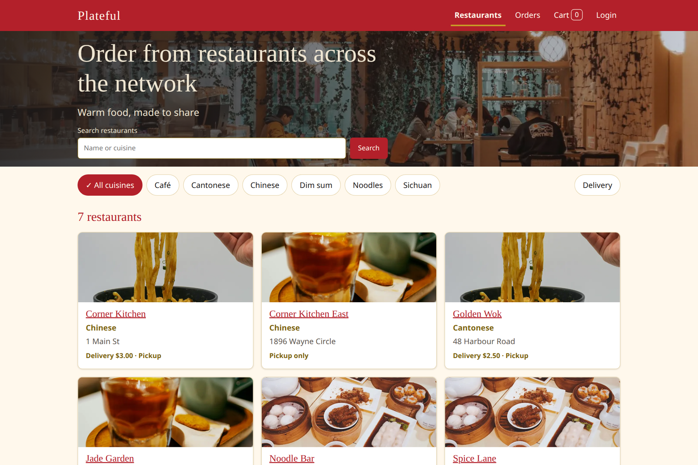
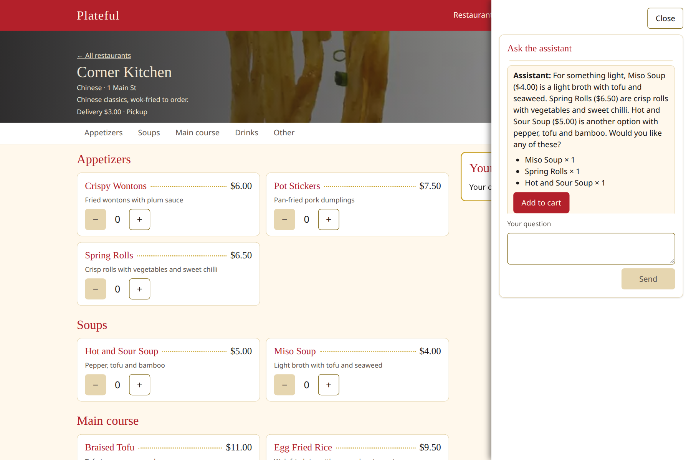
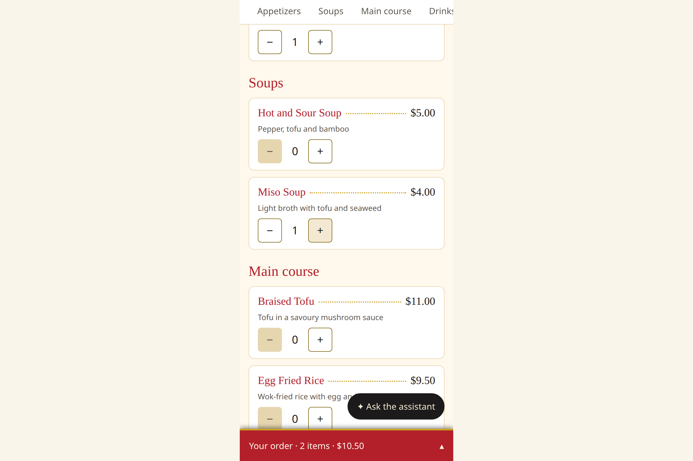
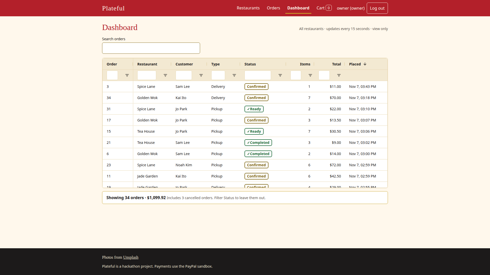
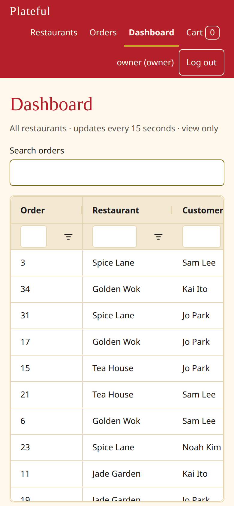

# Plateful

**Order a meal from a network of restaurants in a minute: pick a restaurant, ask an AI assistant for something light, and pay with PayPal.**

Plateful is a marketplace of restaurants. A customer browses by cuisine, opens a menu, and can ask a Claude-powered assistant for a recommendation ("something light"). The assistant's suggestions go into the cart, the customer pays with PayPal, and the restaurant's staff see the paid order and move it from the kitchen to the door. It was built for the [PayPal AI Hackathon](https://paypalaihackathon.devpost.com/).

**Demo video (2 min 41 s):** [Plateful: order with an AI assistant and pay with PayPal](https://youtu.be/VXHrRsa8IpQ)

**Try it in five minutes:** [Run it with Docker Compose](#run-it-docker-compose). You need Docker and your own free PayPal sandbox keys; a Claude key is optional.











## What it does

- **Browse.** Search restaurants and filter by cuisine; each restaurant has a menu grouped by category. The cart survives a page refresh.
- **Ask the assistant.** A chat on the restaurant page answers in plain language and suggests dishes. Every suggestion is checked against that restaurant's real menu on the server, so it cannot invent a dish or a price. The customer still reviews the cart.
- **Pay with PayPal (sandbox).** The server works out the total, delivery fee included, from the prices in its database and creates the PayPal order for exactly that amount. **An order exists only once its payment has been captured**: there is no unpaid order to clean up.
- **Pickup or delivery,** per restaurant, with the delivery fee added on the server.
- **No account needed to order.** After paying, a guest gets an **order code** (12 characters) and can find the order later with it. The lookup shows what was ordered, never the name or the address. A customer who wants their orders together can register and keep them under "My orders".
- **Restaurant staff** sign in to see only the orders of their own restaurant and move them along (confirmed, preparing, ready, out for delivery, completed, or cancelled). An **admin** manages restaurants, menus, delivery settings, users and roles in the Django admin. The **owner** (the boss) signs in at the normal login page and sees a **Dashboard** of every restaurant's paid orders: view only, no order buttons.

## How it uses PayPal and Claude

**PayPal** is the payment step and the reason an order exists.
- The page shows the PayPal JavaScript SDK buttons, configured with a sandbox client ID.
- The backend uses the PayPal Orders v2 REST API: one endpoint starts a checkout and creates the PayPal order, and one captures it after the customer approves.
- The amount comes from the server, never from the browser. Prices are frozen when the checkout starts, so the order equals what PayPal was asked for.
- Capturing is safe to repeat: a second request for the same PayPal order returns the order that exists, so a buyer whose payment went through but whose page failed does not pay twice.
- A card number never reaches this app; card details are typed into PayPal's own window. Only the PayPal sandbox is used.

**Claude** (the Anthropic API) is the menu assistant.
- Only the backend calls the API. The key stays on the server and never reaches the browser.
- The restaurant's menu is read from the database and given to the model, and what it suggests is validated against that menu before the page sees it.
- The model is a setting (a small, fast model by default), and requests are rate limited per client. Without a key the rest of the app still works.


## Built with AI help

This project was built with **Claude Code** (Anthropic's coding agent) as a pair-programmer under the developer's direction, in a spec-driven way: each feature was written down as a change before it was built, and the design decisions are summarised in [docs/architecture.md](docs/architecture.md). The developer wrote the core of the backend (models, serializers, views) and Claude Code wrote the configuration, tooling, documentation and the frontend components, and reviewed the developer's code; for the later features Claude Code wrote more of the code itself. All of it is covered by automated tests (more than 700 backend tests with pytest, and frontend tests with Vitest), and the developer reviewed and ran the result. The app also calls an AI model at run time, as described above.

Built with Django 6.1 and Django REST Framework, PostgreSQL, React, Vite and TypeScript, and Docker Compose. How the pieces fit together: [docs/architecture.md](docs/architecture.md).

## Run it (Docker Compose)

The quickest way to run the whole app on one machine: the database, the API, the page and a small proxy, with one command. You need only [Docker](https://docs.docker.com/get-docker/) (with Compose). Nothing is installed apart from containers, and nothing leaves your machine except the calls to PayPal's sandbox and, if you add a key, to the Claude API.

1. **Create your settings file.** Copy the example and set the two required values:

   ```bash
   cp .env.example .env
   # then edit .env: DJANGO_SECRET_KEY (openssl rand -hex 32) and POSTGRES_PASSWORD (openssl rand -hex 16)
   ```

2. **Add PayPal sandbox keys (to pay for an order).** In the [PayPal developer dashboard](https://developer.paypal.com/dashboard/) (free) go to **Apps & Credentials**, switch to **Sandbox**, create an app, and copy its **Client ID** and **Secret** into `PAYPAL_CLIENT_ID` and `PAYPAL_CLIENT_SECRET`. Then open **Sandbox accounts** and note a **Personal** (buyer) account: you pay with that one, because a real PayPal login does not work in the sandbox.

3. **Optional: a Claude key for the assistant.** Put a key from [console.anthropic.com](https://console.anthropic.com) in `ANTHROPIC_API_KEY`. Without it the assistant says it is unavailable and everything else works.

4. **Start it.**

   ```bash
   docker compose up --build
   ```

   The first build takes a couple of minutes. When the log settles, open **http://localhost:8080**.

5. **Optional: demo staff, admin, owner and customer logins.** A guest can browse, pay and look an order up without any account. To try the restaurant staff queue, the admin site, the owner's dashboard and a customer account, create the demo users once, all with the same password `Password1`:

   ```bash
   docker compose exec backend python manage.py seed_demo_users --password Password1
   ```

   It creates `admin`, `owner`, `demo-customer` and one `staff-<restaurant>` user per restaurant (for example `staff-corner-kitchen`), each with the password **`Password1`**. A fixed password is for this local demo only: without `--password` the command gives each user a random one, printed once. Running it again changes no existing password; to set them all to `Password1` again, add `--reset-passwords`.

**Check that it works:**

- [ ] The page shows the restaurants and a menu when you choose one.
- [ ] Ask the assistant for "something light" and press **Add to cart** (needs the Claude key).
- [ ] Enter your name and check out. Pay with the PayPal button, signing in as the sandbox **Personal** buyer (needs the PayPal keys). There is no "place order" step: the order exists only once the payment succeeds, and the page then shows your **order code** (12 characters, like `XXXX-XXXX-XXXX`). Keep it.
- [ ] Open **Orders**, enter the code under **Find your order**, and see the order with its items, total and status. (Anyone with the code can see what was ordered, but not the name or address.)
- [ ] With the demo users (step 5): sign in at **http://localhost:8080/login** as the staff user of the restaurant you ordered from (for example `staff-corner-kitchen`) and see the paid order in the **Fulfilment** queue. Move it forward a step; refresh the guest's Orders page to see the new status.
- [ ] Sign in at **http://localhost:8080/admin/** as `admin` to see the Django admin (restaurants, menus, orders, users).
- [ ] Sign in at **http://localhost:8080/login** as `owner`: you land on the **Dashboard**, a sortable table of the paid orders of every restaurant with a totals line (view only; the owner has no Fulfilment page and no admin site). The `admin` account does not see the dashboard.
- [ ] Sign in as `demo-customer` and open **My orders**.

**Stop and reset:** `docker compose down` stops it and keeps your orders; `docker compose down -v` also deletes them, so the next start has only the starter restaurants. After changing `PAYPAL_CLIENT_ID`, run `docker compose up --build` again, because the page has it built in.

| Problem | Likely cause and fix |
| --- | --- |
| `set DJANGO_SECRET_KEY in .env` | `.env` is missing or the value is empty. Do step 1. |
| Port 8080 is already used | Set `PROXY_PORT=8081` in `.env` and open that port. |
| The PayPal window says `invalid_client` | The client ID is wrong. Copy it again from the **Sandbox** app, then `docker compose up --build`. |
| "Payment is unavailable" | The PayPal keys are empty in `.env`. |
| "The assistant is not available" | `ANTHROPIC_API_KEY` is empty, or the key is invalid. |
| Signing in says it failed, or the browser shows "CSRF verification failed" | You opened the page at an address other than `http://localhost:8080` (or `127.0.0.1`). Compose trusts only the proxy's own port; if you set `PROXY_PORT`, use that port. |
| A code change does not show up (for example the Dashboard tab for the owner is missing after a pull) | Plain `docker compose up` reuses the old images, and the page is baked into the frontend image. Run `docker compose up --build`. |
| The demo users do not exist, or `Password1` is refused | Run step 5. The users are not created by default; if they were created without `--password`, run it again with `--password Password1 --reset-passwords`. |
| Starting over from nothing | `docker compose down -v`, then `docker compose up --build`. |


## Run it for development (your own servers)

Use this to change the code: the API and the page run directly on your machine, with hot reload, no containers. You need Python 3.14 with [uv](https://docs.astral.sh/uv/), and Node 24 with npm. Use two terminals.

**1. Backend, http://localhost:8000**

```bash
cd backend
export DJANGO_DEBUG=true      # local development only; without it Django needs DJANGO_SECRET_KEY
export PAYPAL_CLIENT_ID=... PAYPAL_CLIENT_SECRET=...   # your PayPal sandbox keys (optional: without them paying answers 503)
export ANTHROPIC_API_KEY=...                           # optional: without it the assistant says it is unavailable
env -u VIRTUAL_ENV uv run python manage.py migrate
env -u VIRTUAL_ENV uv run python manage.py loaddata seed          # the demo restaurants and menus (safe to repeat)
env -u VIRTUAL_ENV uv run python manage.py seed_demo_users --password Password1   # optional: admin, owner, staff and customer logins, all with Password1
env -u VIRTUAL_ENV uv run python manage.py runserver
```

`env -u VIRTUAL_ENV` stops uv from picking up another project's active virtualenv; if you have none active, plain `uv run ...` works. The database is SQLite (`backend/db.sqlite3`, git-ignored) unless `POSTGRES_DB` is set. The API is at http://localhost:8000/api/ and the admin at http://localhost:8000/admin/.

**2. Frontend, http://localhost:5173**

```bash
cd frontend
npm install
cp .env.example .env      # then set VITE_PAYPAL_CLIENT_ID to your sandbox client ID; the API address already points at the local backend
npm run dev
```

The page calls the API directly at `VITE_API_URL` (default `http://localhost:8000/api`). The backend allows the origins `http://localhost:5173` and `http://127.0.0.1:5173`, so open the page at one of those. Vite reads `.env` when it starts, so restart `npm run dev` after changing it. Then follow the use cases below.
## Use cases

Who does what, once it is running at http://localhost:8080. The demo accounts come from step 5 of the guide above (`seed_demo_users --password Password1`), and **all of them use the password `Password1`**; nobody needs an account to order.

| Who | Account | What they can do | What you should see |
| --- | --- | --- | --- |
| **Guest** (a hungry customer) | none | Browse and search restaurants, filter by cuisine, read a menu by category, ask the assistant, fill the cart, choose pickup or delivery, pay with PayPal | After paying: "Payment received" and a 12-character **order code**. The order exists only because the payment succeeded |
| **Guest, later** | none | Open **Orders** and enter the code under **Find your order** | The order's items, total and status. Never the name or the address, so a code can be shared safely |
| **Customer** | `demo-customer`, or **Register** | Keep orders together: find an order by its code and press **Add to my account**, then see all of them under **My orders** | The orders of that customer only |
| **Restaurant staff** | `staff-<restaurant>`, for example `staff-corner-kitchen` | Open **Fulfilment**: the queue of paid orders of **their own restaurant only**, updated every few seconds. Move an order along (confirmed, preparing, ready, then completed, or out for delivery for a delivery order), or cancel it | A new paid order appears in the queue; after a step, the guest's **Orders** page shows the new status |
| **Admin** | `admin` | Sign in at `/admin/` (the Django admin): manage restaurants, menus, delivery settings, orders, users and roles. At the normal login page an admin lands on **Fulfilment** | The admin site. Staff, owners and customers are refused there |
| **Owner** (the boss) | `owner` | Sign in at the normal login page and open the **Dashboard**: every restaurant's paid orders in one table that sorts, filters and searches, with a totals line that follows the filters (the Order column stays in view; it refreshes every 15 seconds) | The table and the totals. No buttons that change an order, no Fulfilment page and no admin site; the admin does not see the dashboard either |

Some things worth trying: pick a restaurant that offers delivery and choose **Delivery** (an address is asked for and the fee is added to the total that PayPal charges); ask the assistant for something it cannot know ("a dish that is not on the menu") and see that it only suggests real dishes; add dishes from one restaurant and then start a cart at another (the page asks before it replaces the cart).

## Also runs on minikube (optional)

The Kubernetes manifests in `k8s/` run the same app on a local minikube cluster, with one command. You need `docker`, `minikube`, `kubectl`, `jq` and `curl`, and the same `.env` file as above.

```bash
scripts/plateful deploy local   # build, load, apply, seed and check; run it again to redeploy
echo "$(minikube -p plateful ip) plateful.local" | sudo tee -a /etc/hosts   # once; then open http://plateful.local
scripts/plateful status local   # what is running
scripts/plateful delete local   # delete everything: the minikube profile and the plateful-* images
```

## Run the tests

```bash
cd backend && env -u VIRTUAL_ENV uv run pytest      # API tests (Python 3.14 and uv)
cd frontend && npm test                              # Vitest, runs once (Node 24)
cd frontend && npm run build                         # type check + production build
cd frontend && npm run lint
```

## Configuration

Backend settings come from environment variables, with local defaults:

| Variable | Default | Purpose |
| --- | --- | --- |
| `DJANGO_SECRET_KEY` | unset | Django secret key. Required unless `DJANGO_DEBUG=true`: without it Django refuses to start. With debug on, a development key is used |
| `DJANGO_DEBUG` | `false` | `true` turns on debug mode and allows the development secret key (local development only) |
| `DJANGO_ALLOWED_HOSTS` | `localhost,127.0.0.1` | Comma-separated hosts |
| `CORS_ALLOWED_ORIGINS` | `http://localhost:5173,http://127.0.0.1:5173` | Comma-separated origins allowed to call the API |
| `PAYPAL_CLIENT_ID`, `PAYPAL_CLIENT_SECRET` | unset | PayPal sandbox credentials. Optional: without them the payment endpoints answer 503 |
| `PAYPAL_API_BASE` | `https://api-m.sandbox.paypal.com` | PayPal API address. Keep the sandbox default |
| `ANTHROPIC_API_KEY` | unset | Claude API key for the menu assistant. Optional: without it the assistant answers 503 |
| `ASSISTANT_MODEL`, `ASSISTANT_RATE` | `claude-haiku-5-5`, `20/min` | Model the assistant uses and the per-client rate limit |
| `POSTGRES_DB`, `POSTGRES_USER`, `POSTGRES_PASSWORD`, `POSTGRES_HOST`, `POSTGRES_PORT` | unset | When `POSTGRES_DB` is set, Postgres is used instead of SQLite |

Frontend: `VITE_API_URL` and `VITE_PAYPAL_CLIENT_ID` (see [frontend/.env.example](frontend/.env.example)). Vite reads it when it starts, so restart `npm run dev` after changing `.env`. Only `VITE_*` variables reach the browser; never put secrets in one.

## Status and what is next

**Works today:** browsing and search, the Claude assistant, the PayPal sandbox checkout (pickup and delivery), guest order codes, customer accounts, the restaurant staff queue, the admin site, and two ways to run it: Docker Compose and minikube. Only the PayPal **sandbox** is used; no real money moves.

**Known limits:** cancelling a paid order does not refund it, because the sandbox moves no real money.

**Next:** a one-command demo deployment on AWS (a disposable cluster that is created for a demo and deleted afterwards). It is not built yet.

## Licence

The code is released under the [MIT licence](LICENSE). The photos in `frontend/src/assets/photos/` are from Unsplash and used under the [Unsplash License](https://unsplash.com/license).
