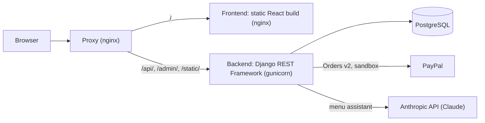
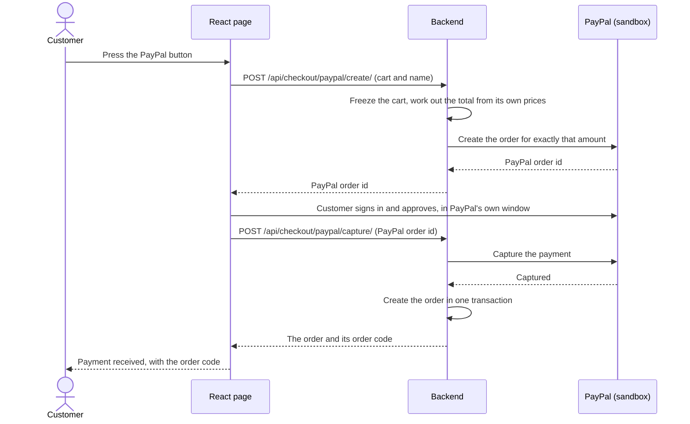

# Architecture

How Plateful is put together today. Code comments refer to numbered design decisions such as "ADR-0014"; the table at the end says what each one decided.

## Overview

Everything the browser talks to is on one origin, so the page and the API share cookies and need no CORS in production. Only the backend calls PayPal and Anthropic; no secret reaches the browser (the PayPal client ID is public by design).

### Paying for an order

An order exists only after its payment has been captured. The browser never tells the server what to charge: the server works out the total itself.

Capturing is safe to repeat: a second capture for the same PayPal order returns the order that already exists, so a buyer whose payment went through but whose page failed does not pay twice.

## Backend (`backend/`)

Django 6.1 and Django REST Framework; project `config`, one app `cafe`. Python 3.14, managed with uv.

- **Domain:** restaurants (cuisine, description, image link, delivery settings), menu categories and items, orders and their items, checkout drafts.
- **Orders exist only after payment.** `POST /api/checkout/paypal/create/` freezes the cart into a draft, works out the total on the server (`cafe/pricing.py`, the one place, delivery fee included) and creates the PayPal order for exactly that amount. `.../capture/` captures it and creates the order in one transaction. Capturing is safe to repeat. Card details never reach the app.
- **Menu assistant** (`cafe/assistant.py`): the restaurant's real menu is given to Claude, and every suggestion is validated against that menu before the page sees it. Rate limited per client. Without a key it answers 503 and the rest of the app works.
- **Who may see an order:** guests get a random 12-character order code (`cafe/codes.py`) and look an order up with `POST /api/orders/lookup/`, which never returns a name or address. Registered customers can attach an order to their account and list them. Staff see only the orders of their own restaurant.
- **Roles and sessions:** roles are Django groups (`fulfilment`, `admin`) with session login under `/api/auth/` and CSRF protection (`cafe/roles.py`, `cafe/permissions.py`). The Django admin is the admin mode, for the admin role only. `manage.py seed_demo_users` creates demo users with random passwords printed once.
- **Order workflow** (`cafe/workflow.py`): confirmed, preparing, ready, out for delivery, completed or cancelled; `POST /api/orders/<id>/transition/` and the staff queue `GET /api/fulfilment/orders/`.
- **Tests:** pytest with pytest-django; more than 700 tests. An access-matrix test decides the allowed access of every route.
- **Settings** come from environment variables. `DJANGO_SECRET_KEY` is required unless `DJANGO_DEBUG=true`. SQLite is used unless `POSTGRES_DB` is set.

## Frontend (`frontend/`)

Vite, React and TypeScript.

- `src/api/` is the typed API module. Pages are in `src/pages/` (discover, restaurant, checkout, orders, staff queue, login) with `react-router`; components in `src/components/` with CSS modules.
- **One order draft** (restaurant, cart, name) lives in a reducer shared through Context and is kept in local storage for 24 hours; a restored cart is checked against the current menu. Every way of adding to the cart asks before replacing a cart of another restaurant.
- All colours, fonts and spacing are CSS custom properties in `src/styles/tokens.css`; a test forbids literal colours and checks text contrast.
- **Tests:** Vitest and React Testing Library next to the code, with the API faked.

## Running it

- **Docker Compose** (`docker-compose.yml`, `compose/proxy.conf`): database, backend, frontend and the proxy, started with one command. The proxy routes `/api`, `/admin` and `/static/` to the backend and everything else to the frontend; the backend trusts the proxy's origin for CSRF.
- **minikube** (`k8s/`, `scripts/plateful`): `k8s/base` holds what every deployment shares (namespace, ConfigMap, Postgres StatefulSet, backend and frontend Deployments, a migration Job, a purge CronJob for stale checkout drafts and the Ingress); `k8s/overlays/local` sets the host name. `scripts/plateful deploy local` builds the images, applies the manifests in three steps (database, migrations, applications), seeds the demo users and checks that payments are configured; `delete local` removes everything it created.
- **Render** (a free hosted copy, with the database moving to an external Postgres later): the page is a static site whose rewrite forwards `/api` to a Docker web service built from `backend/Dockerfile.render`, so the browser sees one origin. How it is set up, its limits and the database move: [docs/deploy-render.md](deploy-render.md).

## Next

A one-command, disposable demo deployment on AWS (a cluster created for a demo and deleted afterwards) is planned. It is not built yet.

## Design decisions

| Number | Decision |
| --- | --- |
| ADR-0001 | One repository with `backend/`, `frontend/` and `k8s/` side by side |
| ADR-0002 | SQLite locally, PostgreSQL in containers, chosen by environment variables |
| ADR-0003 | The developer wrote the core of the backend; Claude Code wrote configuration, tooling and documentation, and reviewed |
| ADR-0004 | A JSON API under `/api/`, an explicit CORS allow-list, no N+1 queries |
| ADR-0005 | pytest and pytest-django for backend tests |
| ADR-0006 | Each feature is written down as a change before it is built |
| ADR-0007 | Vitest and React Testing Library for frontend tests |
| ADR-0008 | The frontend is a static build served by nginx; one origin for page and API |
| ADR-0009 | PostgreSQL as a StatefulSet, migrations as a Job, separate liveness and readiness checks |
| ADR-0010 | The look and feel: a warm red and gold design with serif headings, design tokens, credited Unsplash photos; Claude Code built the components, the developer reviewed |
| ADR-0011 | PayPal sandbox checkout: the server computes the amount, creates and captures the order, and an order exists only after capture |
| ADR-0012 | The Claude menu assistant: suggestions are validated against the real menu |
| ADR-0013 | Planned: deploy to AWS (EKS) for a demo, then delete the cluster |
| ADR-0014 | Roles (fulfilment, admin) as Django groups with session login; guests need no account and use an order code; permissions enforced in the API |
| ADR-0015 | Delivery at checkout (address and fee in the server-side total) and an order workflow for fulfilment |
| ADR-0016 | A marketplace of restaurants, menu categories, page routes, one cart per restaurant |
| ADR-0017 | Two deploy modes (local and, planned, disposable AWS) from one command, with shared manifests |
